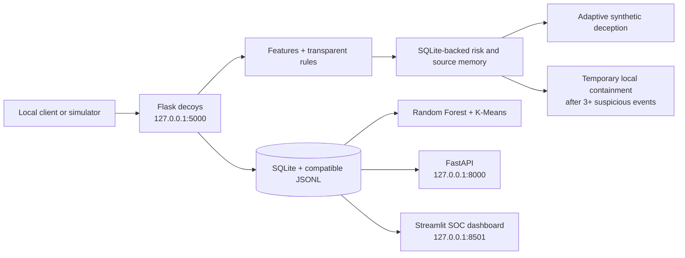

# AI-Honeybot

AI-Honeybot is a local defensive prototype with a Flask decoy, persistent SQLite event/profile/risk memory, a FastAPI service, a Random Forest behavior classifier trained on seeded synthetic scenarios, K-Means profile grouping, adaptive deception, temporary honeypot-only containment, and a Streamlit SOC dashboard. The evidence-led agent can use an optional OpenAI-compatible LLM provider; it defaults to a local model-backed agent and never receives shell tools or response-policy authority. ML labels and clusters are demo triage signals, not ground truth or validated detection performance. It is not a production perimeter defense.

## Problem statement

Security students need a safe way to observe how requests to login and administrative surfaces can look, and to explain how simple behavioral indicators can be turned into triage signals. Real systems and credentials are unnecessary for this learning exercise.

## Objectives

- Provide a controlled decoy web service on loopback.
- Record request metadata and bounded, sanitized request details.
- Explain every risk score using visible indicators.
- Explore captured events through a local dashboard.
- Keep the implementation small enough to inspect and explain.

## Architecture



See [docs/architecture.md](docs/architecture.md) for the event lifecycle and data handling.

## Technologies

- Python 3.10+
- Flask, FastAPI, SQLite and scikit-learn
- Streamlit and pandas for the dashboard
- Python `unittest` for analyzer tests

## Workflow

1. A local client visits `/`, `/login`, or `/admin`.
2. Flask captures timestamp, source IP, method, path, user-agent, and bounded request details.
3. Credential-like values (password, token, secret, authorization, and related field names) are replaced with `[REDACTED]`; arbitrary raw request bodies are not stored.
4. Feature extraction creates a structured `features` object for that interaction. These fields describe request behavior and exclude the baseline risk label/score.
5. Source-IP enrichment first classifies loopback/private addresses locally. For public addresses, an optional local GeoIP database can add approximate location and ASN/network fields; no third-party lookup is made.
6. The rule-based baseline and per-source behavior tracker calculate current and accumulated risk, including escalation indicators across requests.
7. Risk levels are LOW (0–29), MEDIUM (30–59), HIGH (60–79), and CRITICAL (80–100). Temporary containment requires at least three suspicious observations and remains within the honeypot policy.
8. Events, attacker aggregates, risk state, response actions, deception transitions, model metadata and threat reports persist in SQLite; compatible event JSONL remains available.
9. Random Forest classifications and behavior-based K-Means clusters are derived from event history and appear in the FastAPI API and SOC dashboard.

## Detection methodology

The transparent baseline is implemented by `RuleBasedAnalyzer` in `analyzer.py`. It provides explainable risk indicators; a separate Random Forest produces a demo behavior classification. Starting from zero, the rule score adds:

| Indicator | Points |
| --- | ---: |
| Visit `/login` or `/admin` | 15 |
| Unusual method (`PUT`, `PATCH`, `DELETE`, `TRACE`) | 20 |
| Common injection or traversal string in path/details | 35 |
| Scanner-like user-agent (`sqlmap`, `nikto`, `nmap`, etc.) | 25 |
| Missing user-agent | 5 |
| Known synthetic decoy resource accessed | 25 |
| Suspicious SSH-style command observed | 25 |
| 5–9 prior requests from that IP in this process | 10 |
| 10+ prior requests from that IP in this process | 20 |

Scores are capped at 100: **LOW** is 0–29, **MEDIUM** is 30–59, **HIGH** is 60–79, and **CRITICAL** is 80–100. Indicators are attached to each event so the score is explainable. Thresholds are illustrative and should not be interpreted as proof of malicious intent.

### Feature engineering and ML

`extract_behavior_features` produces per-request fields. `behaviour.py` derives history-based frequency, login, endpoint, command, decoy, risk and recurrence metrics. `ml_engine.py` trains a Random Forest on seeded synthetic scenario examples and clusters observed profiles with K-Means. These models are separate from risk policy, and their demo labels are not ground truth.

The original `AnomalyDetector` hook remains optional and unset. The active ML classifier uses synthetic training scenarios, not verified labeled attack data; accuracy is not claimed. If scikit-learn is missing, a transparent rule fallback keeps the service online.

## Source visibility and optional geolocation

Every event retains the immediate peer `source_ip`, timestamp, method, endpoint, user-agent, baseline risk score/level, and matched indicators. The logger does not trust forwarded-IP headers or perform reverse DNS. `source_geo` records an enrichment status and, when available, country/region/city, ASN, organization, network prefix, and approximate coordinates.

Geolocation is **off by default**. To enable local enrichment, install the optional reader package and provide a locally obtained MaxMind-format city database and/or ASN database (observe the data provider's license):

```powershell
python -m pip install maxminddb
$env:HONEYPOT_GEOIP_CITY_DB = "C:\GeoIP\GeoLite2-City.mmdb"
$env:HONEYPOT_GEOIP_ASN_DB = "C:\GeoIP\GeoLite2-ASN.mmdb"
python app.py
```

The ASN database is optional, as is the city database. Without a configured database, public IP location is recorded as unavailable. Loopback, private, and link-local addresses are labelled **Local/Private network** without any database lookup. Other non-public/reserved addresses are also excluded from lookup.

Country, region, city, network, ASN, and map coordinates are approximate database estimates associated with an IP range. They do **not** identify or establish the physical location of a person or device. The optional reader operates on local files only and sends no IP addresses to a geolocation service. The dashboard's map uses only the database's approximate city-level coordinates and labels them accordingly.

## Adaptive risk response

The risk manager persists per-source counts, cumulative risk, prior indicators, authentication attempts, sensitive endpoints, and rapid request timing in SQLite. The feature layer adds escalation indicators for normal browsing followed by sensitive endpoint probes, repeated login attempts, rapid requests and repeated indicators.

| Effective risk | Honeypot response |
| --- | --- |
| LOW (0–29) | Allow and record as `ALLOWED` |
| MEDIUM (30–59) | Allow and record as `MONITORED` |
| HIGH (60–79) / CRITICAL (80–100) | Reject high-risk request; temporary source containment follows multi-event policy |

Effective risk combines the current request score with a decaying cumulative score, capped at 100. A single failed login does not create a persistent block. Temporary containment is configurable but cannot be set below **3 suspicious events**; it applies inside the honeypot for both demo and observed sources and expires by default after 5 minutes. The FastAPI endpoint can explicitly release it. Settings include `MIN_SUSPICIOUS_EVENTS` and `CONTAINMENT_DURATION`/`HONEYPOT_BLOCK_DURATION_SECONDS`.

### Failed login threshold

The decoy has no authentication backend, so each `POST /login` is recorded as a simulated failed attempt; submitted values are redacted and never stored. The first failed attempt is assessed normally and is not blocked by the authentication counter. The second is monitored and remains below HIGH for ordinary repeated-login behavior. The third reaches HIGH and uses the same `TemporaryBlock` mechanism, with the reason **“3 failed authentication attempts”**. Further requests from an actively blocked IP receive the existing generic HTTP 403 until the configured expiry. Set `HONEYPOT_AUTH_BLOCK_AFTER` to change the threshold (default `3`); this is independent of `HONEYPOT_BLOCK_AFTER_HIGH_RISK`, which continues to govern other repeated-HIGH behavior. Independent strong signals can still trigger the normal HIGH-risk response earlier. Private/loopback addresses remain exempt from persistent blocks for unrelated HIGH-risk behavior, but the explicit failed-authentication threshold does apply a temporary block to them so localhost demonstrations exercise the full response lifecycle; the block expires normally.

To support ordinary browser navigation, `GET /login` keeps its form available when its score is elevated only by generic accumulated volume/repeat behavior. Those indicators remain in the event record; scanner-like user-agents, suspicious payloads, unusual methods, and active temporary blocks retain their normal blocking behavior.

SQLite persists risk policy state across Flask restarts. Rejected requests receive only a generic message; detailed indicators are kept in the local event log and database for the dashboard.

## Installation

From the project directory, create and activate an isolated environment, then install the small dependency set:

```powershell
py -m venv .venv
.\.venv\Scripts\Activate.ps1
python -m pip install -r requirements.txt
```

On macOS/Linux, activate with `source .venv/bin/activate` instead.

## Public demo deployment

The public Render service at `/` shows a **synthetic interactive dashboard**; its event sequence runs in the browser and sends no traffic to the backend. `/login` is the fictional decoy sign-in. A second Render service, `ai-honeybot-soc-demo`, runs the multi-view Streamlit SOC dashboard using only in-code synthetic fixture rows. Neither public service reads the live event store or exposes analyst APIs. The full local analyst dashboard and API remain private.

To create the public service, use the Render Blueprint from this repository and select the `main` branch for the Blueprint file. The service definition deploys the `master` branch. It uses Render's free web-service plan, so it may sleep when idle, and its SQLite/event files are on ephemeral storage and can reset after restarts or deploys. Persistent logs require a paid host/storage plan and a separate retention decision.

Requests to the hosted decoy can log source IP, method, path, user-agent, risk results, and sanitized request details while it is running. The synthetic dashboard feed is not logged. Password-like values are redacted. Do not use this demo to collect real credentials or sensitive personal data. This is an educational prototype, not a hardened production honeypot.

See [deployment steps and boundaries](docs/DEPLOYMENT.md) before publishing a service URL.

## Run the honeypot

```powershell
python app.py
```

Open <http://127.0.0.1:5000>. The service binds only to `127.0.0.1` and uses port `5000` by default. Set `HONEYPOT_PORT` to choose another local port. Set `HONEYPOT_EVENTS_FILE` to change the JSONL path. Do not proxy or expose this demonstration to a public or shared network.

Available decoy routes: `/`, `/login` (GET and POST), and `/admin` (GET). Submitted login values are never retained in the event log and no real authentication takes place.

## Run the dashboard

In a second terminal with the environment activated:

```powershell
streamlit run dashboard.py --server.address 127.0.0.1
```

Open <http://127.0.0.1:8501>. The dashboard reads `HONEYPOT_EVENTS_FILE` and refreshes every five seconds. It includes Overview, Sources, Blocked, Details, and AI Agent views. “Active source IPs” and “active suspicious IPs” use the latest event from the last 15 minutes.

## Persistent backend, API, and demo

Install the current dependencies with `python -m pip install -r requirements.txt`. The app writes compatible JSONL and persistent SQLite state (`data/honeybot.sqlite`). Start the FastAPI API on loopback in another terminal:

```powershell
python -m uvicorn api_server:app --host 127.0.0.1 --port 8000
```

The API docs are at <http://127.0.0.1:8000/docs>. Start the complete synthetic sequence with `python scripts/demo_mode.py`; it starts the local API if needed, generates events for a loopback-only simulated source, runs classification/deception/containment, stores a profile, and creates a threat report. The API event simulator rejects non-loopback source IPs. Individual localhost-only scripts are in `scripts/simulate_*.py`.

The SSH-style routes are HTTP simulations at `/ssh/login` and `/ssh/session`; submitted commands are matched against fixed fake outputs and never executed. The Random Forest model uses deterministic synthetic training scenarios. Its prediction and K-Means behavior groups are research/demo signals, not ground-truth labels.

Build and start the isolated Compose stack with `docker compose up --build`. Its only published port is `127.0.0.1:8080`; open <http://127.0.0.1:8080>. Compose was not available in the current development environment, so validate the stack on a host with Docker installed before relying on it.

## Testing

```powershell
python -m unittest discover -s tests -v
```

Tests cover baseline traffic, feature extraction, event logging, the optional analyzer hook, source-IP capture, local/private-IP handling, public-IP enrichment, lookup failures, risk-based ALLOWED/MONITORED/BLOCKED actions, repeated-HIGH temporary blocks, expiry, independent source states, behavioral escalation, scanner/traversal combinations, and score capping.

## Limitations

- Source IP is the immediate peer address. Proxy headers are trusted only inside the isolated Compose network, where Nginx overwrites them.
- The legacy per-process request counter resets on restart; SQLite-backed attacker and risk history persists.
- IP geolocation is approximate, optional, and depends on local database coverage and freshness. No physical location can be inferred from it.
- Rules are simple and can produce false positives or miss novel behavior.
- JSONL is local, append-only, and has no rotation, encryption, or multi-process coordination.
- This project does not isolate a production network service or provide a hardened deployment model.

## Current extension endpoints and synthetic decoys

The decoy includes static, fictional resources at `/.env`, `/credentials.txt`, `/database_backup.sql`, `/api_keys.txt`, `/admin_config.json`, and `/fake_customer_records.csv`, plus a synthetic `/api/*` response. Access to known decoy resources is a scored event. They contain no real secrets or records.

Flask-compatible JSON routes and the OpenAPI FastAPI service provide health, attacks, profiles, timelines, threats, metrics, agent analysis, safe event simulation, containment/release, and threat reports. Profiles derive from persistent SQLite history. The agent defaults to a local Random Forest-backed assessment and can optionally use an OpenAI-compatible LLM through environment configuration; it reports `agent_mode` and `llm_used`. Clusters are descriptive, not ground truth.

## Run and verify locally

```powershell
python -m pip install -r requirements.txt
Copy-Item .env.example .env
python scripts/run_demo_isolated.py
```

The isolated demo starts FastAPI and Streamlit on temporary ports, uses a clean temporary SQLite database, verifies the simulated attack flow and map data, then stops both services and removes the temporary state. For persistent local use, start these commands in separate terminals:

```powershell
python app.py
python -m uvicorn api_server:app --host 127.0.0.1 --port 8000
streamlit run dashboard.py --server.address 127.0.0.1
```

Set `LLM_ENABLED=true`, `LLM_API_KEY`, and `LLM_MODEL` in the untracked `.env` file to opt in to provider calls. The default is the local agent. Docker starts with `docker compose up --build`; only the loopback gateway `127.0.0.1:8080` is published. See [docs/DOCKER_VERIFICATION.md](docs/DOCKER_VERIFICATION.md) for its verification status.

See [CURRENT_STATE](docs/CURRENT_STATE.md), [IMPLEMENTATION_PLAN](docs/IMPLEMENTATION_PLAN.md), [ARCHITECTURE](docs/ARCHITECTURE.md), [API](docs/API.md), [SECURITY](docs/SECURITY.md), [ML](docs/ML.md), [AI agent](docs/AI_AGENT.md), [DEMO](docs/DEMO.md), [DEPLOYMENT](docs/DEPLOYMENT.md), and [presentation outline](docs/PROJECT_PRESENTATION.md).

## Future enhancements

- Evaluate ML using independently labeled data before making accuracy claims; keep its output separate from baseline rule scores.
- Add configurable retention and log rotation.
- Add a time-windowed rate indicator and dashboard filters.
- Add an exportable synthetic demonstration dataset.
- Evaluate rule thresholds against a documented benign/suspicious sample set.

The inspected references informed ideas only: [alpha](https://github.com/ApexProgrammer/alpha) demonstrates a compact deception/dashboard direction; [honeyagents](https://github.com/mrwadams/honeyagents) illustrates agent-generated summaries and response integration (which this project deliberately does not grant autonomous authority); [Adaptive-Honeypot](https://github.com/Mihir4U-avi/Adaptive-Honeypot) describes feature-based detection, persistent profiles and decoy resources. None of their code has been copied into this repository.
- Add structured audit controls and optional offline event replay.
