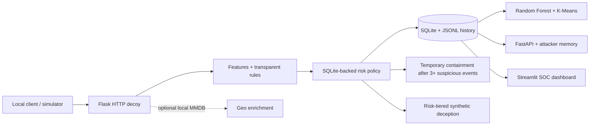

# Architecture

Every captured interaction is normalized with event id, timestamp, source, service, endpoint, sanitized details, behavior features, baseline and effective risk, action, optional model classification, containment/deception transitions and optional GeoIP. SQLite persists events, profiles, risk state, response actions and reports; JSONL remains compatible.

The agent combines recorded evidence and a Random Forest trained on synthetic scenarios, with an optional environment-configured LLM provider for structured triage. It has no shell or arbitrary tool execution; provider output is a recommendation, while the local risk manager remains the authority. The SSH-style interface is a fixed-response HTTP simulation, not an SSH protocol listener. Synthetic map coordinates are labelled as demo data. This remains an academic localhost prototype.
